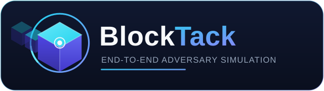

<div align="center">



<br/>
<br/>

**Recon. Exploit. Prove. Report.**

*The adversary-simulation platform for whole blockchain systems — contracts, nodes,
p2p, oracles, off-chain infrastructure, and the economics that hold it together.*

<br/>

[](https://github.com/yasindce1998/BlockTack/actions/workflows/ci.yml)
[](LICENSE)
[](https://go.dev)
[](https://rust-lang.org)
[](corpus/manifest.yaml)
[](corpus/manifest.yaml)

<br/>

**[Quickstart](#-quickstart) · [The corpus](#-the-proving-ground) · [Architecture](#%EF%B8%8F-architecture) · [Roadmap](#-status--roadmap)**

</div>

---

## ⚡ Why BlockTack

Blockchain security tooling today is fragmented: one scanner for static analysis,
another for fuzzing, a script for forks, a spreadsheet for the report. Nobody
replays *history* to prove their tooling actually works.

**BlockTack is one campaign platform** that does all of it, and proves itself
against real exploits:

- **Full-stack taxonomy** — 52 weakness classes across six layers, from RPC
  exposure to economic design, each with concrete remediation guidance
- **Attacks, not just findings** — eclipse a geth node with an attacker swarm,
  manipulate an oracle from deployed bytecode, drain a vault with a signed PoC
- **History as the regression suite** — the attackers' own transactions from
  Euler 2023, Curve/Vyper 2023, and KyberSwap 2023 (mainnet **and**
  Arbitrum One) replay on mainnet forks, profits verified **to the wei**
- **Zero-footprint simulation** — entire attack sequences execute in-memory
  (revm) against fork state: no broadcast, not even to a local chain
- **Client-ready output** — kill chains with financial blast radius, and
  engagement reports you can actually hand to a customer

<div align="center">

```
$ bin/blocktack campaign --target corpus/fixtures/naive-oracle-vault/target.yaml \
    --playbook playbooks/evm/naive-oracle-vault.yaml

kill chain: [critical] End-to-end oracle manipulation kill chain
  stage: Weakness identified: Oracle dependency: latestAnswer() (BTV-L2-003)
  stage: Exploit premise confirmed by simulation (no transaction broadcast)
  stage: Exploit executed on-chain and profit verified
  financial impact: 14.999936 ETH (14999935592435371203 wei)
campaign finished: 6 findings
```

*One command. Weakness → simulated exploit → executed exploit → verified profit.*

</div>

## 🎚️ Three tiers of realness

BlockTack is built for professional engagements, so it is explicit about what is
synthetic, what is real-but-sandboxed, and what runs against live approved systems:

| Tier | What runs where | Examples |
|---|---|---|
| **1 · Synthetic** | disposable fixture chains | corpus fixtures, Damn Vulnerable DeFi wargame |
| **2 · Real data, sandboxed** | local forks of real mainnet state | historical incident replays, revm in-memory simulation |
| **3 · Live, approved** | read-only against your authorized systems | recon, node-audit, oracle mapping, `simulate-call` probes |

> **Nothing ever touches mainnet.** Tier-2 replays re-broadcast signed
> historical transactions *only* to a local anvil fork; tier-3 read-only
> probing requires an explicit authorization block (who, scope, expiry),
> and safe mode confines everything else to loopback.

## 🧭 The attack surface

Every finding, playbook, and report is classified against a machine-readable
taxonomy of 52 weakness classes across six layers (`bin/blocktack matrix`):

| Layer | Scope | BlockTack capabilities |
|---|---|---|
| **L0** Infrastructure | RPC exposure, node config, secrets | recon, RPC fuzzing (DoS detection), web audit, CVE cross-reference |
| **L1** Node & consensus | clients, p2p, mempool, validators | fingerprinting, mempool surveillance, peer-topology analysis, **eclipse execution** |
| **L2** Contracts & programs | EVM, Solana BPF, Move, CosmWasm | bytecode oracle mapping, Slither + Foundry adapters, **revm multi-tx simulation**, eth_call state overrides |
| **L3** Cross-chain | bridges, relayers, light clients | replay-domain and proof-verification checks *(roadmap)* |
| **L4** Off-chain | oracles, indexers, frontends, keys | oracle staleness detection, web-root secret exposure, headers, listings |
| **L5** Economic & governance | incentive design, MEV | balance-delta profit verification, kill-chain composition with financial blast radius |

## 🚀 Quickstart

Requires [Go](https://go.dev) 1.27+, Rust, and [Foundry](https://getfoundry.sh).
[Geth](https://geth.ethereum.org) ≥ 1.14 is optional (eclipse campaign only).

```sh
make build            # Go CLI + both Rust engines
make test             # full test suite
bin/blocktack matrix  # browse the 52-weakness taxonomy
```

<details>
<summary><strong>▶ Run every campaign type</strong></summary>

```sh
# Full-stack oracle exploit: deploy → map oracles from bytecode →
# simulate the skewed-price borrow (no broadcast) → execute on-chain →
# verify profit → forge PoC → kill chain + financial impact
bin/blocktack campaign \
  --target corpus/fixtures/naive-oracle-vault/target.yaml \
  --playbook playbooks/evm/naive-oracle-vault.yaml

# Damn Vulnerable DeFi wargame corpus (6 challenges)
bin/blocktack campaign \
  --target corpus/damn-vulnerable-defi/target.yaml \
  --playbook playbooks/evm/damn-vulnerable-defi.yaml

# Historical incidents on mainnet forks (archive-capable RPC; FORK_URL to override)
bin/blocktack campaign --target corpus/euler-2023/target.yaml \
  --playbook playbooks/evm/euler-incident-replay.yaml
bin/blocktack campaign --target corpus/curve-vyper-2023/target.yaml \
  --playbook playbooks/evm/curve-vyper-incident-replay.yaml       # + revm simulation
bin/blocktack campaign --target corpus/kyberswap-2023/target.yaml \
  --playbook playbooks/evm/kyberswap-incident-replay.yaml

# Node layer: CVE cross-reference, RPC fuzzing, mempool, peer topology
bin/blocktack node-audit --target examples/targets/local-anvil.yaml

# Eclipse execution: a geth attacker swarm locks down a victim's peer slots
bin/blocktack campaign --target corpus/fixtures/p2p-eclipse/target.yaml \
  --playbook playbooks/evm/p2p-eclipse.yaml

# Off-chain web audit · Solana recon
bin/blocktack node-audit --target corpus/fixtures/off-chain-api/target.yaml --module web-audit
bin/blocktack campaign --target examples/targets/solana-devnet.yaml \
  --playbook playbooks/solana/devnet-fingerprint.yaml

# Engagement-grade report from any campaign output
bin/blocktack report --findings runs/campaigns/<run>/findings.json \
  --target <target.yaml> --engagement --out report.md
```

</details>

## 🏆 The proving ground

`corpus/manifest.yaml` tracks real exploits as regression targets with
`pending → detected → reproduced` statuses. Current scoreboard:

<div align="center">

| Class | Count | Examples |
|---|---|---|
| Synthetic fixture classes | 2 | oracle manipulation, reentrancy |
| Damn Vulnerable DeFi | 6 | naive-receiver · the-rewarder · free-rider · puppet-v2 · side-entrance · compromised |
| **Historical incidents** | **4** | **Euler 2023 (~$197M) · Curve/Vyper 2023 · KyberSwap 2023 (mainnet) · KyberSwap 2023 (Arbitrum One)** |

*Euler: 15 transactions, ~$197M within 0.1%. Curve: 6,106.7513… WETH, exact to the
wei. KyberSwap mainnet: 11 token balances exact. KyberSwap Arbitrum: 12/12 txs
identical hashes, 13/15 profit tokens exact to the raw unit. Every profit verified
against the on-chain record, on forks, with zero live-chain traffic.*

</div>

The Curve incident is proven **three ways** — revm in-memory simulation →
anvil fork broadcast → mainnet on-chain record — with identical gasUsed and
balances at every stage:

```text
simulate-tx-sequence (revm, in memory):   tx1 gas=1,693,119  tx2 gas=38,647  tx3 gas=53,489
re-broadcast on anvil fork:               identical gasUsed, identical state deltas
mainnet record (block 17806055):          6,106.751307562450092427 WETH profit — exact match
```

## 🏗️ Architecture

Go orchestrates, Rust computes, Python glues to the existing analysis
ecosystem. Everything crosses process boundaries as JSON or SARIF.
Chain-specific engines live in `engine-<chain>/` and speak one job/findings
contract — new chains are drop-in.

```text
blocktack CLI (Go) ── matrix · recon · scan · node-audit · campaign · report
      │
      ├── internal/ (Go modules)
      │     recon · nodeaudit (cve/fuzz/mempool/peers/web) · p2pattack
      │     playbook runner (shell/engine/adapter/builtin/manual steps)
      │     correlate (kill chains + financial blast radius)
      │     report (severity dump + engagement-grade renderer)
      │
      ├── adapters/ (Python)          Slither · Foundry
      │                               passing test_poc_* = confirmed finding
      │
      ├── engine-evm/ (Rust, alloy + revm)
      │     fingerprint · map-oracles · verify-pnl · oracle-staleness
      │     simulate-call (state overrides) · erc20-balance
      │     simulate-tx-sequence (in-memory multi-tx, mainnet-exact)
      │
      └── engine-solana/ (Rust)       fingerprint · balance (JSON-RPC)

executed against: anvil forks · foundry EVMs · geth swarms · live RPCs (read-only)
```

## 🛡️ Guardrails

Authorization is not optional. Every target must declare an authorization
block (who, scope, expiry); safe mode (the default) restricts contactable
endpoints to loopback or explicitly allow-listed hosts; going beyond requires
an explicit `--unsafe`. Campaigns are fully logged with per-step artifacts,
and the replay workflows broadcast only to local forks.

<div align="center">

**Only test systems you are authorized to test.**
See [docs/authorization.md](docs/authorization.md).

</div>

## 🗺️ Status & roadmap

Feature-complete across L0/L1/L2/L4/L5 with three historical incidents
reproduced. Open items — non-EVM incident replays (Ronin, Wormhole), L2/L3
multi-chain sandboxes, bridge model checkers, Move/CosmWasm engines,
timejacking — are tracked in [docs/roadmap.md](docs/roadmap.md).

## 📂 Repository layout

```text
cmd/blocktack/        CLI (Go)
internal/core/        target, finding, taxonomy models
internal/recon/       L0/L1 endpoint probing
internal/nodeaudit/   cve-check · rpc-fuzz · mempool · peers · web-audit
internal/p2pattack/   eclipse-state verification
internal/playbook/    campaign runner (all step types)
internal/correlate/   kill-chain composition, financial blast radius
internal/report/      severity report + engagement renderer
internal/webaudit/    off-chain web exposure checks
adapters/             Python adapters (Slither, Foundry)
engine-evm/           EVM engine (Rust: alloy + revm)
engine-solana/        Solana engine (Rust)
taxonomy/             52-weakness attack matrix (with remediation)
playbooks/            declarative attack campaigns (11 EVM + 1 Solana)
corpus/               exploit regression corpus + vendored incidents
examples/targets/     target definitions
docs/                 architecture · roadmap · authorization · logo
```

<div align="center">

**MIT License** — see [LICENSE](LICENSE)

<sub>Built for defenders. Proof over promises.</sub>

</div>
